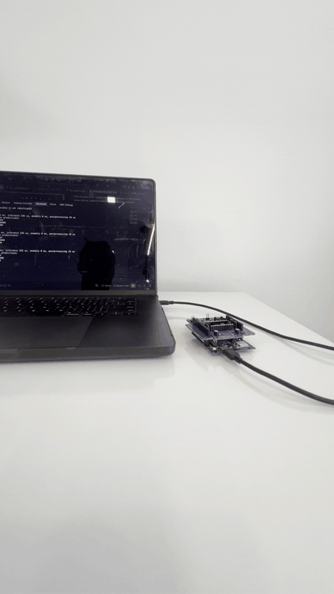
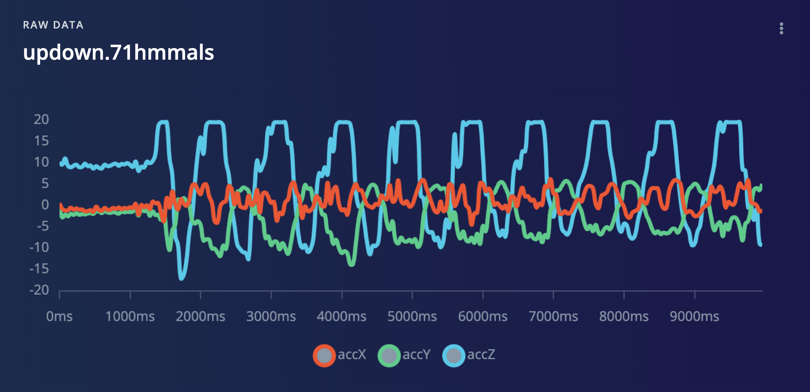
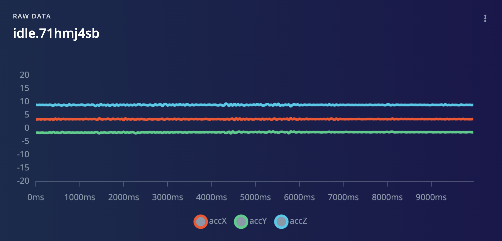
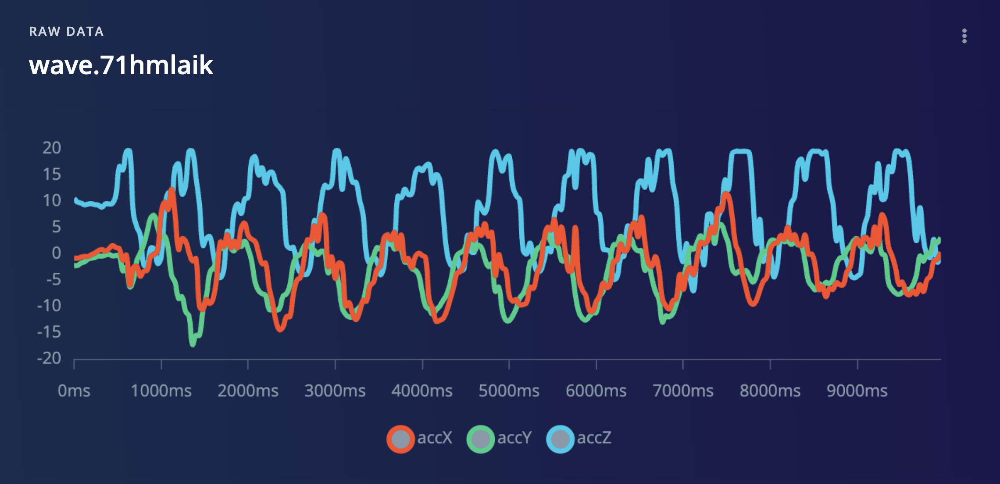
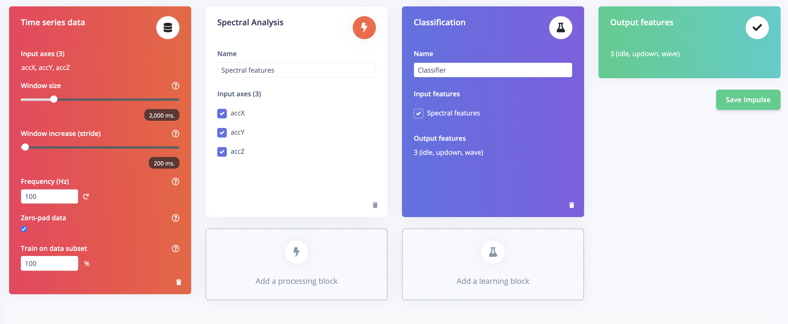
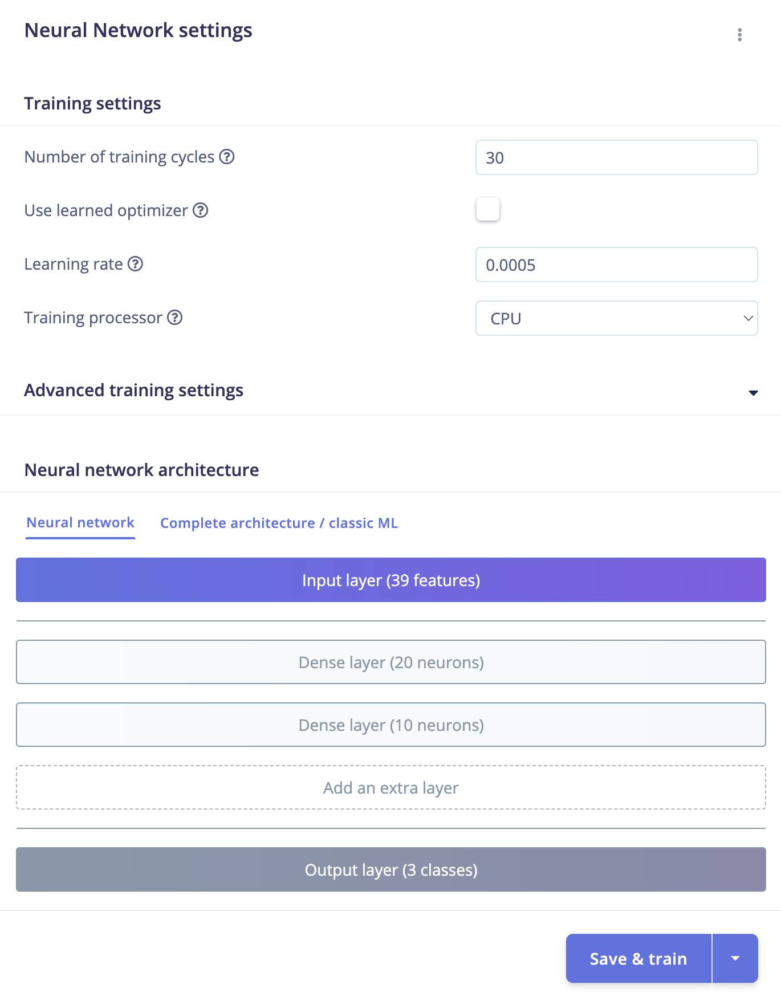
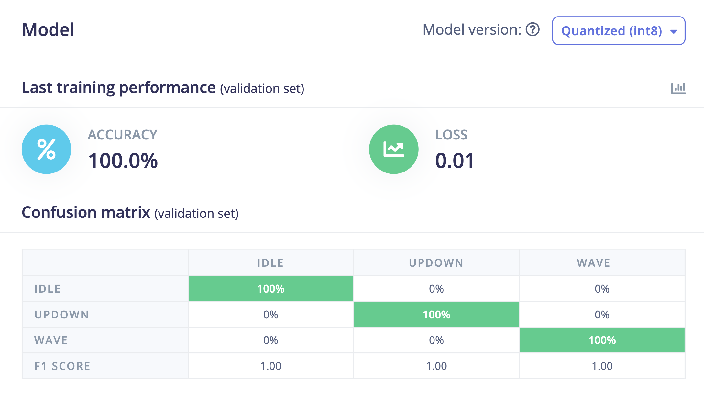
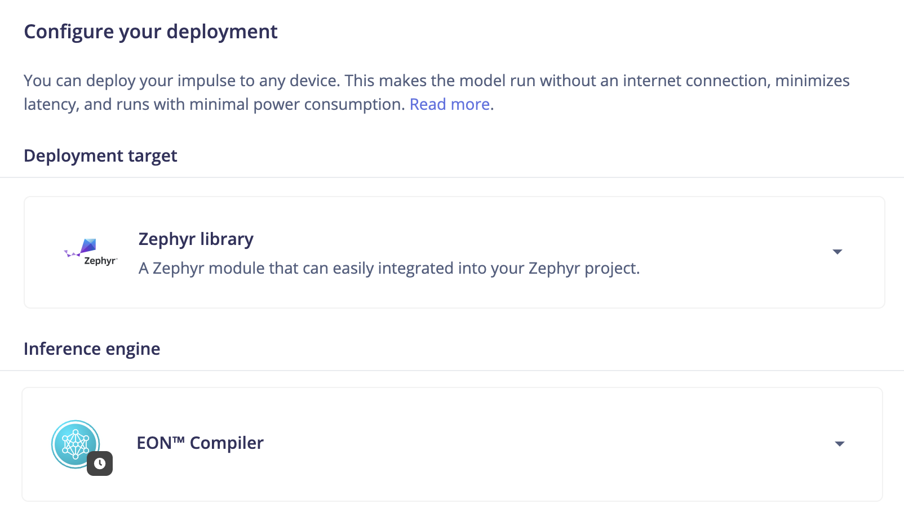

# Gesture recognition and over-the-air model updates on the Arduino UNO Q

Train an accelerometer gesture model (**idle / wave / updown**) in Edge Impulse Studio, run it on the
STM32 side of the **Arduino UNO Q** with the **X-NUCLEO-IKS4A1** sensor shield on Zephyr RTOS, and push
new models to the board **over the air** with Golioth. No cable, no manual re-flash.

The board updates its own microcontroller: the Linux side pulls a new firmware image from Golioth over
Wi-Fi and flashes the STM32 itself.



---

## What's in here

```
.
├── west.yml                     West manifest: pulls Zephyr + Edge Impulse SDK into the workspace
├── firmware/
│   ├── data-forwarder/          Firmware 1: streams accel x,y,z at 100 Hz for data collection
│   │   └── boards/arduino_uno_q.overlay   Routes the console to lpuart1 (REQUIRED, see below)
│   └── inference/               Firmware 2: runs your trained model (Edge Impulse example + IKS4A1 support)
│       ├── boards/arduino_uno_q.overlay   Same console overlay (REQUIRED here too)
│       └── model/               <- you unzip your Edge Impulse "Zephyr library" here (git-ignored)
├── patches/iks4a1.patch         The IKS4A1 changes against upstream ei-zephyr-imu-inference, for reference
├── scripts/
│   ├── build.sh                 Build a firmware app (forwarder | inference)
│   ├── bridge.sh                Start the on-board SWD bridge (runs on the board via adb)
│   ├── flash.sh                 Flash from your laptop over the bridge (gdb load)
│   └── ei_capture.py            Read /dev/ttyHS1 and upload labelled data to Edge Impulse
├── ota/
│   ├── ota_gateway.py           Runs on the board: polls Golioth, downloads, flashes, reports state
│   ├── flash_board.sh           Board-local flasher the gateway calls (OpenOCD over gpiochip1)
│   ├── golioth.env              Device credentials + config for the gateway (fill in your own)
│   └── golioth-ota.service      systemd unit so the gateway runs at boot and restarts on failure
└── docs/                        Beginner's guide + proposal
```

Two firmwares, one board: you flash `data-forwarder` first to record training data, then `inference`
with your model inside. Both read the same sensor (LIS2DUXS12) in the same units, so training and live
data match. Both need the same console overlay.

---

## Hardware

| Part | Notes |
| --- | --- |
| Arduino UNO Q | Linux side (Qualcomm QRB2210) handles USB/Wi-Fi; STM32U585 runs Zephyr and the model |
| X-NUCLEO-IKS4A1 | Jumpers **J4 and J5 on 1-2 and 11-12** (Mode 1, factory default). Other modes hide the sensors from Zephyr |
| USB-C cable / PD dongle | The board runs Linux; give it a proper power source |

---

## UNO Q realities (read this first)

The UNO Q is two computers on one board: a Qualcomm chip running Debian Linux (owns USB and Wi-Fi) and an
STM32U585 running Zephyr (runs your model). That split breaks three assumptions the normal Zephyr flow makes.

**1. `west flash` from your laptop does not work.** It spawns OpenOCD on your laptop, which has no debug
adapter. The programmer lives on the board's Linux side. You flash by running a bridge *on the board* and
driving it with gdb from your laptop (see [Flashing](#flashing)).

**2. The console does not go to USB.** The board default routes the STM32 console to `usart1` on pins
PB6/PB7 (the D0/D1 header pins). Nothing on Linux or your laptop can read those. The UART wired to the
Linux side is `lpuart1` (PG5-PG8). Each app here ships a `boards/arduino_uno_q.overlay` that re-points the
console to `lpuart1`. Zephyr auto-applies it by filename, no extra flag. **If you build a new app for this
board, copy that overlay in or you get silence.**

**3. You read output on the board, not on your laptop.** With the console on `lpuart1`, the STM32's output
surfaces on the board's Linux side as `/dev/ttyHS1`. The `arduino-router` service holds that port, so you
stop it first (see [Reading serial output](#reading-serial-output)).

### The four-terminal mental model

Once you internalise where each thing runs, the workflow is four terminals:

| Terminal | Where | What |
| --- | --- | --- |
| 1 | Laptop | `scripts/build.sh` — build the firmware |
| 2 | Laptop | `scripts/bridge.sh` — launches the SWD bridge (it runs on the board via adb; leave it open) |
| 3 | Board (`adb shell`) | `chmod 666 /dev/gpiochip1` before the bridge, then read `/dev/ttyHS1` |
| 4 | Laptop | `scripts/flash.sh` — load the firmware over the bridge |

**The bridge runs on the board, not your laptop.** `bridge.sh` is launched from the laptop but uses `adb`
to start the debug bridge on the board's Linux side and forwards port 3333 back to you. That is why the
`chmod 666 /dev/gpiochip1` runs on the board: the board is its own debug probe, bit-banging SWD through
`gpiochip1`.

---

## Quick start

### 1. Install tools (once)

Build host is your laptop (Linux or macOS). Ubuntu 22.04/24.04:

```bash
sudo apt update && sudo apt install --no-install-recommends git cmake ninja-build gperf \
  ccache dfu-util device-tree-compiler wget python3-dev python3-pip python3-setuptools \
  python3-tk python3-wheel python3-venv xz-utils file make gcc gcc-multilib g++-multilib \
  libsdl2-dev libmagic1 android-tools-adb
```

macOS: `brew install cmake ninja gperf python3 ccache dtc libmagic wget android-platform-tools`

### 2. Create the Zephyr workspace (once)

```bash
mkdir -p ~/unoq-ml && cd ~/unoq-ml
python3 -m venv .venv && source .venv/bin/activate
pip install west

west init -m https://github.com/gigwegbe/machine-learning-model-ota-on-arduino-uno-q.git .
west update                                    # downloads Zephyr + modules, takes a while
west zephyr-export
pip install -r zephyr/scripts/requirements.txt
west sdk install --toolchains arm-zephyr-eabi
```

You now have `~/unoq-ml/machine-learning-model-ota-on-arduino-uno-q/` (this repo) next to `zephyr/` and
`modules/`. All commands below run from inside this repo with the venv active:

```bash
cd ~/unoq-ml && source .venv/bin/activate && cd machine-learning-model-ota-on-arduino-uno-q
```

> **Already have a Zephyr workspace?** You do not need to re-`west init`. Just `git clone` this repo next
> to your existing `zephyr/` and `modules/`, and build from inside it. `west build` uses the Zephyr and
> modules already in the workspace.

### 3. Collect data

Build and flash the data forwarder:

```bash
scripts/build.sh forwarder
scripts/bridge.sh          # Terminal 2 - leave running, wait for "Listening on port 3333"
scripts/flash.sh forwarder # Terminal 4
```

Before the first flash after any reboot, run `sudo chmod 666 /dev/gpiochip1` on the board (`adb shell`),
or the bridge fails with a GPIO permission error.

A successful build ends like this:

```
[190/190] Linking C executable zephyr/zephyr.elf
Memory region         Used Size  Region Size  %age Used
           FLASH:       45184 B         2 MB      2.15%
             RAM:        7328 B       768 KB      0.93%
```

`FLASH: ~45 KB` = the data-forwarder. (The inference build with the model is ~145 KB — a quick way to tell
the two apart.)

---

## Reading serial output

The console is on `lpuart1`, which surfaces on the board's Linux side as `/dev/ttyHS1`. The
`arduino-router` service owns that port by default, so stop it first. On the board (`adb shell`):

```bash
sudo systemctl stop arduino-router arduino-router-serial
sudo fuser -k /dev/ttyHS1          # clear anything still holding the port
sudo stty -F /dev/ttyHS1 115200 raw -echo
cat /dev/ttyHS1
```

Move the board. For the forwarder you should see three numbers per line at ~100 Hz, one axis near ±9.8
when still:

```
0.182,0.479,9.677
0.191,0.488,9.686
0.182,0.469,9.705
```

**Quit with `Ctrl-C`, never `Ctrl-Z`.** `Ctrl-Z` only suspends `cat`, and a suspended `cat` keeps holding
the port — that is what causes the "Device or resource busy" pile-up. If the port stays busy, something is
respawning and grabbing it; stop `arduino-router` and `arduino-router-serial`, then `sudo fuser -k
/dev/ttyHS1` and read again.

---

## Capture data to Edge Impulse

The stock `edge-impulse-data-forwarder` does not work here (it only accepts USB serial devices, and our
data is on `/dev/ttyHS1` on the board). Use the included capture script instead, **on the board**:

```bash
# one-time: pyserial on the board
sudo apt-get update && sudo apt-get install -y python3-serial   # or: pip install --break-system-packages pyserial

python3 scripts/ei_capture.py --label idle   --seconds 10    # repeat per label
python3 scripts/ei_capture.py --label wave   --seconds 10
python3 scripts/ei_capture.py --label updown --seconds 10
```

It reads `/dev/ttyHS1` and posts to the Edge Impulse ingestion API. Record at least ~2 minutes each of
`idle`, `wave`, `updown`, then in Studio do **Perform train/test split**.





---

## Train the model

**Create impulse** — these settings must match the firmware (especially the 100 Hz frequency):

- Time series data: window size **2000 ms**, window increase (stride) **200 ms**, frequency **100 Hz**,
  input axes `accX, accY, accZ`
- Processing block: **Spectral Analysis**
- Learning block: **Classification**
- Output: **3 classes** (idle, updown, wave)



**Neural network settings** used here:

- Training cycles: **30**, learning rate **0.0005**, processor CPU
- Architecture: Input layer (39 features) → Dense (20) → Dense (10) → Output (3 classes)
- Model version: **Quantized (int8)**



**Result** on this dataset: **100% validation accuracy, loss 0.01**, clean confusion matrix, F1 1.00 per
class.



> The 100% is flattering: the gestures are distinct and the dataset is small. Treat it as "the pipeline
> works," not "production ready." Record more variety (speeds, orientations, a second person) to harden it.

---

## Deploy: export the Zephyr library

Studio → **Deployment** → **Zephyr library** with the **EON™ Compiler** (int8 quantized) → **Build**, then
download the zip.



The Edge Impulse SDK links the model into the firmware at build time (EON-generated C), so the model is
not a separate file — it is compiled into the inference firmware. Unzip the export into the inference app's
`model/` directory:

```bash
rm -rf firmware/inference/model/* 2>/dev/null
unzip -o ~/Downloads/<your-project>-zephyr-vN.zip -d firmware/inference/model/
```

You should see `model-parameters/`, `tflite-model/`, and a `check_version.cpp`.

---

## Build the inference firmware

```bash
scripts/build.sh inference
```

A successful inference build:

```
[876/876] Linking CXX executable zephyr/zephyr.elf
Memory region         Used Size  Region Size  %age Used
           FLASH:      145504 B         2 MB      6.94%
             RAM:       38112 B       768 KB      4.85%
```

**Judge the build by `zephyr.bin`, not `zephyr.elf`.** The ELF is ~5 MB because it carries debug symbols
that never reach the chip; the `.bin` (~145 KB) is the actual flashed content. A ~45 KB bin is the
forwarder; a ~145 KB bin has the model.

**Identify the build by the 145 KB bin, but ship the `.elf`** — OpenOCD needs the load addresses only the
ELF carries.

> **`Edge Impulse SDK and model metadata version mismatch`?** Your exported model was generated against a
> different SDK revision than the one in the workspace. Fix it with `west update edge-impulse-sdk-zephyr`,
> then rebuild `--pristine`. If it persists, re-export the Zephyr library from Studio so model and SDK are
> from the same moment.

---

## Flashing

Flashing goes through a bridge on the board plus gdb on your laptop. `scripts/bridge.sh` and
`scripts/flash.sh` wrap this; the raw commands are here so you know what they do.

**The bridge runs on the board, not your laptop.** `scripts/bridge.sh` is launched from your laptop but it
does not run there. It uses `adb` to start the debug bridge on the board's Linux side (you will see
`Linux GPIOD` and `Cortex-M33 detected` in its output, which come from the board) and forwards port 3333
back to your laptop. So `scripts/flash.sh` on the laptop connects to `localhost:3333` and `adb` tunnels it
to the board, where the bridge bit-bangs SWD through `gpiochip1` into the STM32. The board is its own debug
probe. That is also why the `chmod 666 /dev/gpiochip1` below runs on the board, not the laptop.

**Prerequisite, every boot.** On the board (`adb shell`):

```bash
sudo chmod 666 /dev/gpiochip1
```

This resets on reboot. Without it the bridge dies with `Cannot open LinuxGPIOD chip 1`.

**Terminal 2, the bridge** (`scripts/bridge.sh`):

```bash
adb forward tcp:3333 tcp:3333 && adb shell arduino-debug
```

Leave it running; wait for `Listening on port 3333`.

**Terminal 4, the flash** (`scripts/flash.sh`). This loads the ELF over the bridge with gdb from the Zephyr
SDK:

```bash
~/zephyr-sdk-1.0.1/gnu/arm-zephyr-eabi/bin/arm-zephyr-eabi-gdb build/zephyr/zephyr.elf \
  -ex "target extended-remote localhost:3333" \
  -ex "load" \
  -ex "monitor reset run" \
  -ex "detach" -ex "quit"
```

`west flash -r openocd` is not used, because the debug adapter is on the board, not your laptop.

Read the predictions the same way as the data (console on `lpuart1`). For the inference firmware you get
class labels instead of raw CSV:

```
#Classification predictions:
  idle: 0.937500
  updown: 0.054688
  wave: 0.007812
Timing: DSP 29 ms, inference 236 us, anomaly 0 ms, postprocessing 19 us
```

---

## Over-the-air model updates (Golioth)

Once the local loop works, `ota/` delivers new models wirelessly instead of over the bridge. The board's
Debian side is the Golioth device: it pulls the desired firmware version over the Golioth device HTTP
gateway, flashes the STM32 locally, and reports state back.

```
Golioth console (browser)  ──upload ELF──▶  Golioth cloud
                                                 │ desired version
                                                 ▼
                              board: ota_gateway.py  ──downloads ELF──▶  flash_board.sh
                                                                              │ OpenOCD / gpiochip1
                                                                              ▼
                                                                            STM32
```

### 1. Register the device in Golioth

Create a project, add a device, copy its **PSK-ID** and **PSK** from the Credentials tab, and assign it to
the cohort you deploy to. (The console flow — project, device, packages, cohort, deployment — is covered
step by step in the companion article:
[Seamless ML Model Updates for Edge Devices](https://www.hackster.io/gigwegbe/seamless-ml-model-updates-for-edge-devices-a4c2e2).)

### 2. Configure the gateway

`ota/golioth.env` holds the device credentials and config. Fill in your own:

```bash
GOLIOTH_PSK_ID=your-device-psk-id@your-project
GOLIOTH_PSK=your-device-psk
GOLIOTH_PACKAGE=firmware
GOLIOTH_POLL_SECONDS=30
GATEWAY_FLASH_CMD="/home/arduino/scripts/flash_board.sh {path}"
```

> `GATEWAY_FLASH_CMD` **must be quoted** (it contains a space and `{path}`), and the script it points at
> **must be `chmod +x`**. Exit 126 means "not executable"; exit 127 means "not found".

### 3. The board-local flasher

`ota/flash_board.sh` flashes the STM32 **on the board** using the on-board OpenOCD over `gpiochip1` — no
laptop, no gdb bridge. It is different from `scripts/flash.sh` (the laptop one).

```bash
#!/usr/bin/env bash
# flash_board.sh — flash the STM32 on the UNO Q, on the board itself.
# Called by ota_gateway.py as:  flash_board.sh <path-to-firmware.elf>
set -euo pipefail

ELF="${1:?usage: flash_board.sh <firmware.elf>}"
GPIOCHIP=/dev/gpiochip1
OCD_TELNET=4444

# 1) Must be an ELF. Read the 4-byte magic with python3 (xxd is not on the board).
magic=$(python3 -c 'import sys; print(open(sys.argv[1],"rb").read(4).hex())' "$ELF" 2>/dev/null || true)
if [ "$magic" != "7f454c46" ]; then
  echo "[flash] ERROR: $ELF is not an ELF (magic=$magic)"; exit 1
fi

# 2) SWD needs write access to the GPIO chip (the systemd unit sets this as root; fallback for manual runs).
chmod 666 "$GPIOCHIP" 2>/dev/null || true

# 3) Bring up the on-board OpenOCD SWD server (same tool bridge.sh uses).
arduino-debug >/tmp/flash-ocd.log 2>&1 &
OCD_PID=$!
trap 'kill "$OCD_PID" 2>/dev/null || true' EXIT

# 4) Wait for OpenOCD's telnet command port.
for _ in $(seq 1 30); do
  if (exec 3<>"/dev/tcp/localhost/$OCD_TELNET") 2>/dev/null; then exec 3>&- 3<&-; break; fi
  sleep 1
done

# 5) Program + verify + reset via OpenOCD's command interface.
python3 - "$ELF" <<'PY'
import socket, sys, time
elf = sys.argv[1]
s = socket.create_connection(("localhost", 4444), timeout=180)
time.sleep(0.5)
for c in (f"program {elf} verify reset", "shutdown"):
    s.sendall((c + "\n").encode()); time.sleep(1)
out = b""
s.settimeout(180)
try:
    while True:
        b = s.recv(4096)
        if not b: break
        out += b
except Exception:
    pass
text = out.decode(errors="replace")
print(text)
sys.exit(0 if "verified" in text.lower() else 1)
PY
rc=$?
echo "[flash] done rc=$rc"
exit $rc
```

Install it on the board:

```bash
chmod +x /home/arduino/scripts/flash_board.sh
```

### 4. Run the gateway

`ota/ota_gateway.py` is standard-library only (no pip installs). Test one cycle first:

```bash
export GOLIOTH_PSK_ID=...  GOLIOTH_PSK=...  GOLIOTH_PACKAGE=firmware
export GATEWAY_FLASH_CMD="/home/arduino/scripts/flash_board.sh {path}"
python3 ota/ota_gateway.py          # one poll + update cycle
python3 ota/ota_gateway.py --watch  # poll forever
```

A clean cycle reads `up to date (version N)` or downloads, flashes, and prints `now running firmware-N`.

### 5. Run it as a service (survives reboots)

`ota/golioth-ota.service`:

```ini
[Unit]
Description=Golioth OTA gateway for Arduino UNO Q
After=network-online.target
Wants=network-online.target

[Service]
Type=simple
User=arduino
EnvironmentFile=/home/arduino/golioth.env
ExecStartPre=+-/bin/chmod 666 /dev/gpiochip1
ExecStart=/usr/bin/python3 /home/arduino/scripts/ota_gateway.py --watch
Restart=always
RestartSec=10

[Install]
WantedBy=multi-user.target
```

```bash
sudo cp ota/golioth-ota.service /etc/systemd/system/
sudo cp ota/golioth.env /home/arduino/golioth.env     # edit with your credentials
sudo systemctl daemon-reload
sudo systemctl enable --now golioth-ota
journalctl -u golioth-ota -f                           # watch it
```

- `ExecStartPre=+-/bin/chmod 666 /dev/gpiochip1`: the `+` runs this as root (the service runs as `arduino`,
  which cannot chmod the device); the `-` tolerates failure so it never blocks startup.
- `After/Wants network-online.target`: hold start until the network is up, so the first poll can resolve DNS.
- `Restart=always`: bring the gateway back if it crashes or the network drops.

### 6. Publish a new version

From the Golioth console: **Packages → firmware → New Version**, upload `firmware/inference/build/zephyr/zephyr.elf`,
set the version → **Cohorts → your cohort → Deploy**, select that version → **Start Deployment**.

Within `GOLIOTH_POLL_SECONDS` the board catches it, flashes, and resets into the new model:

```
[ota-gateway] update available: 9 -> 10
[ota-gateway] downloading https://gw.golioth.io/.u/c/firmware@10
[ota-gateway] sha256 verified
** Programming Finished **
** Verified OK **
** Resetting Target **
[flash] done rc=0
[ota-gateway] now running firmware-10
```

**No reboot is needed** — `flash_board.sh` resets the STM32 at the end of programming, so the new model is
live the moment flashing finishes. A reboot only helps if you want to free `/dev/ttyHS1` to watch the
serial console.

---

## How the IKS4A1 support works

Upstream `ei-zephyr-imu-inference` knows the IKS02A1 and IKS01A3 shields. `patches/iks4a1.patch` (already
applied in `firmware/inference`) adds a third option following the same pattern:

- `Kconfig`: new `CONFIG_EI_IKS4A1` symbol
- `CMakeLists.txt`: selects Zephyr's upstream `x_nucleo_iks4a1` shield and the new sensor sources
- `src/sensors/iks4a1/ei_accelerometer.cpp`: **LIS2DUXS12** — the sensor that feeds the classifier
- `src/sensors/iks4a1/ei_inertial.cpp`: **LSM6DSV16X** 6-axis IMU (initialised, not yet used by inference)

Sensor ODRs were changed to values those chips actually support (LIS2DUXS12: 400 Hz; LSM6DSV16X: 480/240
Hz). The upstream values (1600 / 416 Hz) are silently rejected by these drivers.

**Two UNO-Q-specific `prj.conf` points.** The shield overlay enables every sensor on the IKS4A1, and the
LIS2MDL magnetometer faults during init on this board and crashes the firmware to `0x00000000` before it
prints anything. Disable the sensors you do not read:

```
CONFIG_I2C=y
CONFIG_SENSOR=y
CONFIG_LIS2DUX12=y

CONFIG_LSM6DSV16X=n
CONFIG_LIS2MDL=n

CONFIG_REQUIRES_FLOAT_PRINTF=y
CONFIG_CONSOLE=y
CONFIG_UART_CONSOLE=y
CONFIG_SERIAL=y
CONFIG_MAIN_STACK_SIZE=2048
```

**Do not add `CONFIG_LPS22DF=n`.** That symbol does not exist (the driver is `LPS2XDF`), and Zephyr treats
the unknown-symbol warning as fatal, aborting the build.

**The console overlay** (`boards/arduino_uno_q.overlay`) must be present in *every* app or the firmware
runs but prints to a dead UART:

```dts
/ {
    chosen {
        zephyr,console = &lpuart1;
        zephyr,shell-uart = &lpuart1;
    };
};

&lpuart1 {
    status = "okay";
    current-speed = <115200>;
};
```

---

## Building without the scripts

```bash
# data forwarder
cd firmware/data-forwarder
west build --pristine -b arduino_uno_q -- -DSHIELD=x_nucleo_iks4a1

# inference
cd firmware/inference
west build --pristine -b arduino_uno_q -- -DCONFIG_EI_IKS4A1=y
```

Always build `--pristine` after changing an overlay, `prj.conf`, or a board flag — a plain `west build`
reuses the cached CMake config and can silently ignore the change. Confirm the console overlay took:

```bash
grep console build/zephyr/zephyr.dts      # expect: zephyr,console = &lpuart1
```

---

## Troubleshooting

| Symptom | Fix |
| --- | --- |
| `west: command not found` | Activate the venv: `source ~/unoq-ml/.venv/bin/activate` |
| `adb devices` is empty | Different cable/port; wait for Linux to boot; `adb kill-server && adb start-server` |
| Bridge dies with `Cannot open LinuxGPIOD chip 1` | `sudo chmod 666 /dev/gpiochip1` on the board. Resets every reboot |
| `Debug Adapter has to be specified` | You ran `west flash -r openocd` on the laptop. Use the bridge + gdb method instead |
| `ERROR: LIS2DUXS12 not ready` | Re-seat the shield; check J4/J5 jumpers are in Mode 1 |
| `No supported IMU shield defined` | You forgot `-DCONFIG_EI_IKS4A1=y` |
| `No model found` / `model_metadata.h: No such file` | Unzip the Studio export into `firmware/inference/model/` |
| `Edge Impulse SDK and model metadata version mismatch` | `west update edge-impulse-sdk-zephyr`, then rebuild `--pristine` |
| `attempt to assign the value 'n' to the undefined symbol LPS22DF` | Remove that line; the driver is `LPS2XDF`, not `LPS22DF` |
| Firmware halts at `0x00000000` | An unused shield sensor faulted at init. Disable it in `prj.conf` (start with `CONFIG_LIS2MDL=n`) |
| **Nothing on serial, even though it flashed** | The app was built **without** `boards/arduino_uno_q.overlay`. Console went to `usart1` (dead). Add the overlay, rebuild `--pristine` |
| `/dev/ttyHS1` busy / changing PIDs | `arduino-router` keeps grabbing it. `sudo systemctl stop arduino-router arduino-router-serial`, then `sudo fuser -k /dev/ttyHS1`. Quit `cat` with `Ctrl-C`, never `Ctrl-Z` |
| Gateway: `Temporary failure in name resolution` | DNS on the board. `ping gw.golioth.io`; if it fails, set DNS on the connection: `sudo nmcli connection modify "<conn>" ipv4.dns "8.8.8.8 1.1.1.1" ipv4.ignore-auto-dns yes`, then bounce the connection |
| Gateway flash: exit 126 | The flash script is not executable: `chmod +x flash_board.sh` |
| Gateway flash: exit 127 | The flash script path is wrong / not found |
| Gateway flash: `is not an ELF (magic=)` | `xxd` is not on the board; the magic read came back empty. Read the magic with `python3`, not `xxd` |
| Service still runs the old config after you edited the env | Editing an env file does nothing until you **restart** the service, and a shell `export` never reaches a unit. Verify with `sudo tr '\0' '\n' < /proc/$(systemctl show -p MainPID --value golioth-ota)/environ \| grep GATEWAY` |

---

## References

- Edge Impulse — Arduino UNO Q Zephyr tutorial: <https://docs.edgeimpulse.com/tutorials/topics/zephyr/arduino-unoq-zephyr>
- Edge Impulse — data forwarder: <https://docs.edgeimpulse.com/tools/clis/edge-impulse-cli/data-forwarder>
- Edge Impulse — ei-zephyr-imu-inference (upstream): <https://github.com/edgeimpulse/ei-zephyr-imu-inference>
- Golioth — device OTA API (CoAP, mirrored on HTTP): <https://docs.golioth.io/reference/device-api/api-docs/ota>
- Companion article — Seamless ML Model Updates for Edge Devices: <https://www.hackster.io/gigwegbe/seamless-ml-model-updates-for-edge-devices-a4c2e2>
- Zephyr — X-NUCLEO-IKS4A1 shield: <https://docs.zephyrproject.org/latest/boards/shields/x_nucleo_iks4a1/doc/index.html>
- Zephyr — Arduino UNO Q board: <https://docs.zephyrproject.org/latest/boards/arduino/uno_q/doc/index.html>

## License

`firmware/inference` is derived from Edge Impulse's `ei-zephyr-imu-inference` (Clear BSD; see
`firmware/inference/LICENSE`). Everything else in this repo is released under the same license.
